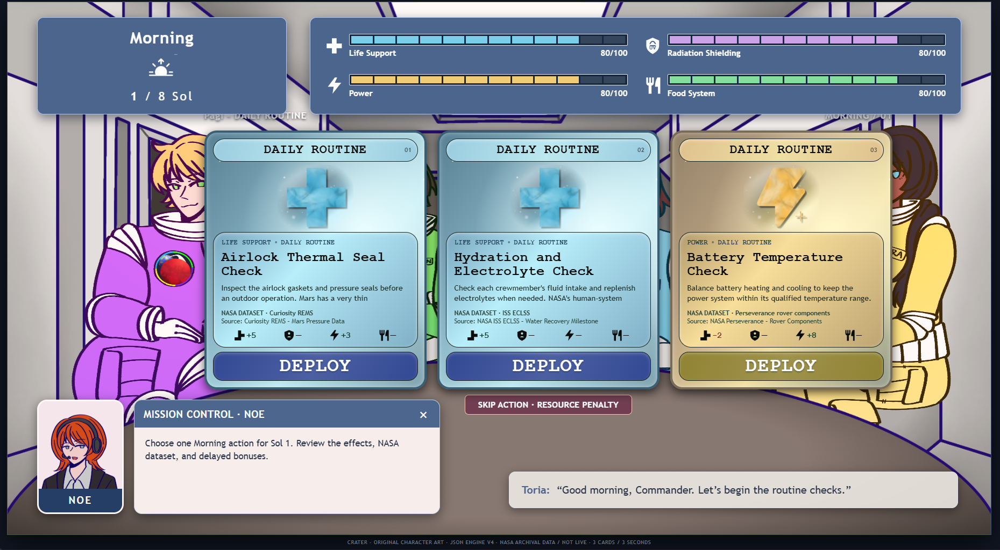

# CRATER - Junior Astronaut Mission Trainer

**NASA Space Apps Challenge 2026 submission**  
**Challenge: Build a Junior Astronaut Mission Trainer**

CRATER is an interactive Mars-outpost game that invites students to make the decisions a mission commander faces: keep life support, radiation shielding, power, and food systems working while caring for a crew far from Earth.

## The challenge and our approach

Space-mission trade-offs can be presented either too simply to feel meaningful or with more engineering detail than a young learner can follow. CRATER makes those trade-offs tangible through short, readable decisions. Students review a card, see its meter effects and science context, choose what to do, and observe how the outpost responds over an eight-Sol mission.

The goal is not to model a real spacecraft precisely. It is to help players reason about connected systems, delayed consequences, limited supplies, and the risks of putting one need ahead of another.

## Learning goals

- Understand that an outpost depends on several connected systems, not one resource alone.
- Compare the consequences of daily operations, research, exploration, construction, upgrades, and repairs.
- Practice prioritizing immediate needs while considering delayed effects and mission risks.
- Connect game decisions to science facts and the source material shown with each card.

## How to play

1. Follow the Mission Control briefing from Noe, which introduces the crew, Sols, meters, and card choices.
2. During each active phase, wait for the three-second transmission and review the three offered cards.
3. Choose one card to apply its effects, or skip the offer and accept the resource penalty. A disaster may interrupt the phase and present repair (FIX) cards.
4. At night, distribute available food and water rations among the crew, review the outpost, and end the Sol.
5. Continue through up to eight Sols. Protect all four systems and keep the crew well enough to complete the mission.

### Mission systems

| System | What it represents |
| --- | --- |
| Life Support | Air, water, and other habitat support |
| Radiation Shielding | Protection from the space environment |
| Power | Energy available to run the outpost |
| Food System | Food supplies and production |

All four meters start at 80 out of 100. If any meter reaches 40 or below, the mission ends early. Crew condition and nightly rations also matter; completing Sol 8 with the systems above the failure threshold completes the campaign.

### Mission timeline

| Phase | Card activities |
| --- | --- |
| Morning | Operations / daily routines |
| Afternoon | Research and exploration |
| Evening | Construction and upgrades |
| Night | Rations, resource production, meter changes, and Sol review |
| Disaster response | Repair / FIX cards |

Card effects can change more than one meter, and some cards schedule a later meter effect. Skipping a normal choice or a repair choice also has a cost. The engine applies these rules and tracks the mission state.

## Card catalog

The active catalog contains 80 cards in [`engine/data/cards.json`](engine/data/cards.json). Each card includes its title, description, activity category, meter effects, primary-meter classification, and science-source metadata.

| Activity category | Number of cards |
| --- | ---: |
| Operations / daily routine | 20 |
| Research | 10 |
| Exploration | 10 |
| Construction / building | 10 |
| Upgrade | 10 |
| Repair / FIX | 20 |
| **Total** | **80** |

Cards are also grouped by their primary outpost system. This classification is curated from the card's purpose and context; it is not simply the meter with the largest numerical effect.

| Primary system | Operations | Research | Exploration | Construction | Upgrade | Repair | Total |
| --- | ---: | ---: | ---: | ---: | ---: | ---: | ---: |
| Life Support | 14 | 4 | 3 | 4 | 2 | 5 | 32 |
| Shielding | 0 | 2 | 3 | 3 | 2 | 5 | 15 |
| Power | 3 | 1 | 2 | 2 | 4 | 5 | 17 |
| Food | 3 | 3 | 2 | 1 | 2 | 5 | 16 |
| **Total** | **20** | **10** | **10** | **10** | **10** | **20** | **80** |

The card interface presents the NASA dataset and source name, and provides a source link when one is available. The catalog is the source of truth for card content; the engine validates it before use.

## Screenshots

**Mission briefing and outpost HUD**


**Three-card decision screen**



## Science sources and simulation limits

Card facts link to source metadata in the catalog, including NASA, NASA Jet Propulsion Laboratory, NASA CCMC DONKI, and research references. Examples include:

- [NASA's MOXIE oxygen-generating experiment](https://www.nasa.gov/solar-system/nasas-oxygen-generating-experiment-moxie-completes-mars-mission/)
- [NASA's water-recovery milestone on the International Space Station](https://www.nasa.gov/missions/station/iss-research/nasa-achieves-water-recovery-milestone-on-international-space-station/)
- [NASA/JPL report on the May 2024 Mars solar storm](https://www.jpl.nasa.gov/news/nasa-watches-mars-light-up-during-epic-solar-storm/)
- [NASA Veggie plant-growth fact sheet](https://www.nasa.gov/wp-content/uploads/2019/04/veggie_fact_sheet_508.pdf)

The solar-particle event used in the game is based on a historical NASA CCMC DONKI archive record and mapped to a simulated mission timeline. It is not a live data feed, a forecast for Mars, or a measurement made at the CRATER outpost. Meter changes, event timing, and outcomes are game-design values, not engineering predictions.

The catalog preserves broader GDD metadata, but not every field currently drives a gameplay rule. The playable engine currently applies immediate and delayed meter effects, phase and repair choices, disasters, skip penalties, nightly rations, and campaign outcomes. For example, card assignment, cost, bonus, and status-effect metadata are not all implemented as full game systems.

## Technology

- React and TypeScript for the interface, tutorial, card choices, and mission HUD.
- Phaser for the Mars outpost scene and crew visuals.
- A TypeScript game engine and JSON card catalog for game state, draws, meter changes, saves, and outcomes.
- Vite for local development and production builds; Vitest for automated tests.

## Run locally

Use Node.js 20.19+ or 22.12+.

```bash
npm ci
npm run dev
```

Open the local URL printed by Vite. To check the project:

```bash
npm run typecheck
npm test
npm run build
```

## Project structure

| Path | Purpose |
| --- | --- |
| `src/App.tsx` | Main game interface, tutorial, card flow, and HUD |
| `src/phaser/OutpostScene.ts` | Phaser outpost scene |
| `src/mission/` | Mission briefing and ending presentation |
| `src/bridge/` | React-to-Phaser state and event bridge |
| `engine/data/cards.json` | Active 80-card catalog and source metadata |
| `engine/logic/` | Game rules, phase flow, meter updates, and persistence |
| `engine/tests/` and `tests/` | Engine, interface, and integration tests |
| `public/assets/` | Interface, crew, outpost, and card artwork |

---

Built for learning through play: every Sol is a chance to weigh competing needs and see how a mission decision changes the outpost.
