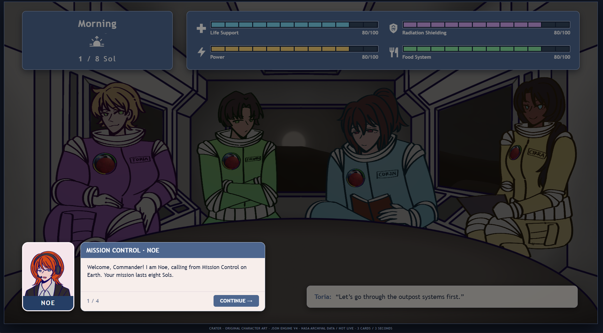
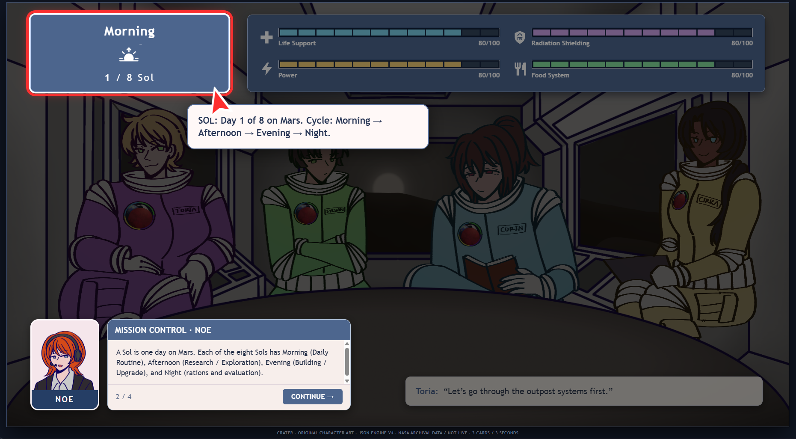
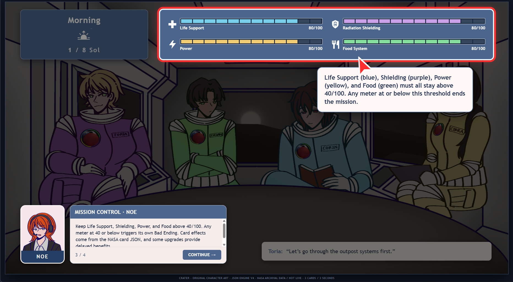
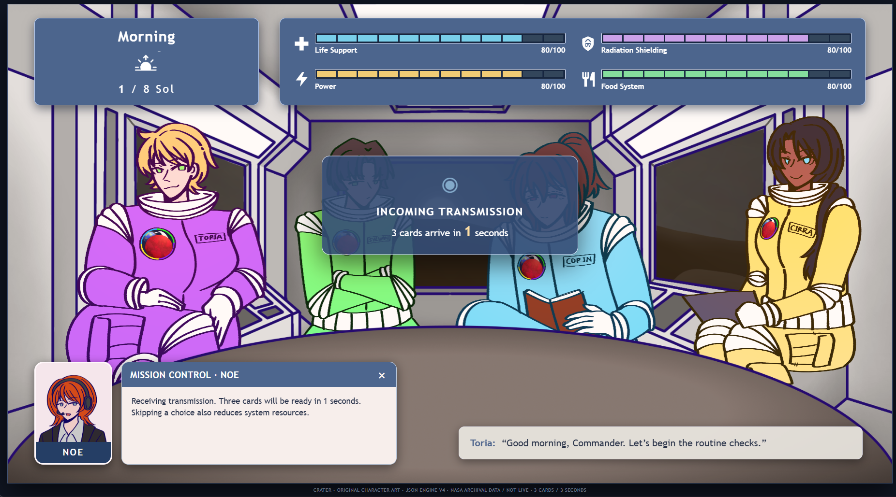
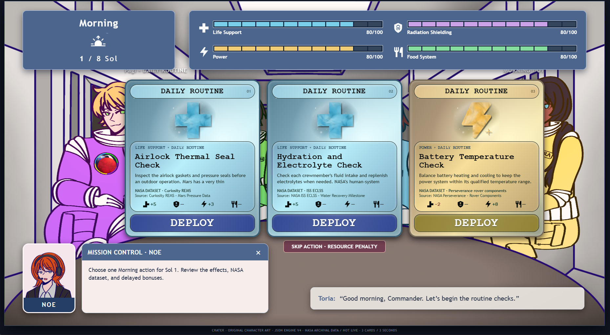

# CRATER - Mars Outpost Mission Trainer

**NASA Space Apps Challenge 2026 | Build a Junior Astronaut Mission Trainer**

**Play the web app:** [crater-ten.vercel.app](https://crater-ten.vercel.app/)

CRATER is a playable Mars-outpost web game. The player receives messages from Mission Control, chooses actions for the crew, manages four outpost systems, and tries to complete an eight-Sol mission.

## What the website can do

- **Introduce the mission:** cinematic opening and a step-by-step briefing from Noe, Mission Control.
- **Show an interactive outpost scene:** Phaser renders the habitat and crew while React displays the mission interface.
- **Track the mission:** a HUD shows the current Sol, phase, and four system meters.
- **Offer card decisions:** after a three-second transmission, choose one of three cards or skip the action. Cards show their category, description, meter effects, NASA dataset, and source details; some also show delayed effects.
- **Run the daily cycle:** play phase-appropriate actions, then distribute food and water rations to individual crew members at night.
- **Respond to hazards:** disasters damage the outpost and offer three repair (FIX) cards. The game includes dust storms, solar-particle events, airlock leaks, and water/plant-system failures.
- **Show mission outcomes:** failure or completion is followed by a report with the Sol, final meter values, and number of cards played. Start a new mission with **PLAY AGAIN**.
- **Play atmospheric audio:** background music starts after the first user interaction, following browser autoplay rules.

## A mission at a glance

One mission lasts up to eight Sols (Martian days). Each begins at Morning and moves through the following phases:

| Phase | Available actions |
| --- | --- |
| Morning | Operations and daily routines |
| Afternoon | Research and exploration |
| Evening | Construction and upgrades |
| Night | Assign food and water rations, then end the Sol |
| During a disaster | Choose a repair / FIX card |

At each card offer, the player sees three choices. Playing a card applies its meter effects; some effects are scheduled for a later Sol. Skipping an offer applies a penalty. At night, ration choices affect crew condition, while the engine also calculates resource production, irrigation, solar recovery, and system decay.

## Systems and mission outcomes

All four meters start at 80/100. If any meter reaches 40 or below, the mission fails. The player must also keep the crew from reaching the engine's all-crew-unwell abort condition. Completing Sol 8 without an abort completes the mission.

| Meter | Represents |
| --- | --- |
| Life Support | Air, water, and habitat support |
| Shielding | Radiation protection |
| Power | Energy for outpost systems |
| Food | Food supply and production |

The card interface also classifies every card by its primary system. This is a curated grouping based on the card's purpose, separate from the card's actual effects.

## The card library

The web app uses the 80-card catalog in [`engine/data/cards.json`](engine/data/cards.json):

| Card category | Count |
| --- | ---: |
| Operations | 20 |
| Research | 10 |
| Exploration | 10 |
| Construction | 10 |
| Upgrade | 10 |
| Repair | 20 |
| **Total** | **80** |

Card facts include source metadata. When a card is played, Noe's message shows its dataset and provides an external source link when available.

## Science and simulation notes

The card catalog references NASA, NASA Jet Propulsion Laboratory, NASA CCMC DONKI, and research sources. The solar-particle scenario uses a historical NASA CCMC DONKI archive record mapped to a simulated mission phase. It is **not live monitoring, a Mars forecast, or a reading from the CRATER outpost**. Meter effects and hazard timing are game rules, not real mission predictions.

Some metadata in the card JSON is reserved for future expansion. The current game applies meter effects, delayed meter effects, phase and repair choices, hazards, skip penalties, nightly rations, and mission outcomes; it does not implement every card field as a gameplay system.

## Screenshots

**01 - Noe introduces herself as the communicator from Earth**



**02 - Day and time, with progress from Sol 1 to Sol 8**



**03 - Outpost meters and their critical thresholds**



**04 - Mission tutorial**


**05 - Waiting for an incoming transmission and card offer**



**06 - Card display and action selection**



## Run the website locally

Use Node.js 20.19+ or 22.12+:

```bash
npm ci
npm run dev
```

Open the local URL printed by Vite. Project checks:

```bash
npm run typecheck
npm test
npm run build
```

The main experience is the React/Phaser app launched by Vite. `demo.html` is a separate standalone prototype.

## Main project files

| Path | Role |
| --- | --- |
| `src/App.tsx` | Tutorial, mission HUD, card selection, rations, and outcome report |
| `src/phaser/OutpostScene.ts` | Mars outpost scene and crew visuals |
| `src/mission/` | Opening and ending cinematics |
| `src/bridge/` | Connects game state to the Phaser scene |
| `engine/data/cards.json` | Active card definitions and source metadata |
| `engine/logic/` | Mission phases, draws, effects, rations, hazards, and outcomes |
| `public/assets/` | Scene, crew, card, and audio assets |
